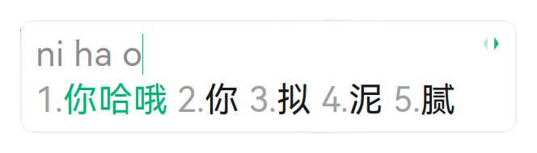

# 仿微信的 fcitx4 输入法皮肤 / WeChat Light for fcitx4

把 [**fcitx5-theme-wechat**](https://github.com/witt-bit/fcitx5-theme-wechat) 的浅色主题移植到 **fcitx4** 的经典界面（`fcitx-classic-ui`），适用于 UOS 20、Deepin 及仍在使用 fcitx4 的发行版。



## 原主题

| | |
|---|---|
| 项目 | **fcitx5-theme-wechat** |
| 仓库 | https://github.com/witt-bit/fcitx5-theme-wechat |
| 作者 | witt |
| 许可 | Apache-2.0 |

原主题面向 **fcitx5**，格式是 `theme.conf` + SVG（9-slice），而 fcitx4 只认 `fcitx_skin.conf` + 九宫格 PNG，**两者不兼容，无法直接安装**。本仓库按原主题的配色、圆角与排版规格，重新绘制了 fcitx4 所需的位图素材，做成语义上尽量接近的移植版。

## 效果与规格对应

| 原主题（fcitx5） | 本移植（fcitx4） |
|---|---|
| 底色 `#ffffff`、描边 `#f0f0f0`、圆角 10 | `input.png` 240×160，圆角 16px、2px 描边 |
| 高亮 `#02b176` + 白字 | fcitx4 没有「候选项高亮药丸」，改用**首选词绿色**近似 |
| 正文 `#000000` | 候选 `#1A1A1A` |
| 拼音 `#000000` | 拼音/编码 `#8C8C8C` 灰 |
| 内容边距 10/10 | `Margin 20/36/16/16`（按 2 倍缩放换算） |

其他细节：光标与翻页箭头同为微信绿 `#02B176`；圆角处透出壁纸（依赖桌面合成器，KWin 下正常）。

## 安装

```sh
git clone https://github.com/<your-name>/fcitx4-theme-wechat.git
cp -r fcitx4-theme-wechat/wechat ~/.config/fcitx/skin/
```

> **注意目录**：一定要放在 `~/.config/fcitx/skin/`，**不是** `~/.local/share/fcitx/skin/`。
> 后者能被 fcitx 扫描到并出现在皮肤列表里，但真正加载时会失败并静默回退到默认皮肤（`skin.c:130 无法加载皮肤`），这是 fcitx4 的路径查找限制。

然后编辑 `~/.config/fcitx/conf/fcitx-classic-ui.config`：

```ini
[ClassicUI]
FontSize=16
SkinType=wechat
```

最后重启 fcitx —— **皮肤只在进程启动时读取**，改配置后 `fcitx-remote -r` 之类的热重载不生效：

```sh
fcitx-remote -e    # 退出
sleep 2
fcitx -d           # 重新启动
```

## 关于 2 倍缩放（HiDPI）

素材是按 **192 DPI（系统缩放 200%）** 绘制的：字号、描边、圆角、留白都是 2 倍尺寸。

fcitx4 的 `classicui.c` 只在**进程启动时**调用一次 `FcitxX11GetDPI()` 读 `Xft.dpi`。如果 fcitx 比桌面环境更早启动（写 `Xft.dpi` 的是 DDE/GNOME 的会话管理），它会按 96 DPI 缓存整个会话，候选窗就只有一半大小——**重启一次 fcitx 即可恢复**。

在 100% 缩放下使用本皮肤会显得偏大，可自行调整 `fcitx_skin.conf` 里的 `Margin*`。

## 卸载

```sh
rm -rf ~/.config/fcitx/skin/wechat
```

再删掉 `fcitx-classic-ui.config` 里的 `SkinType` 行即可回到默认皮肤。

## 许可

沿用原主题的 **Apache-2.0**（见 [LICENSE](LICENSE)），原版权归 witt 与 `fcitx5-theme-wechat` 贡献者所有。

本仓库是在原主题视觉设计基础上的**修改版本**（modification）：将 fcitx5 主题格式转换为 fcitx4 皮肤格式，并重新绘制了全部位图素材。
