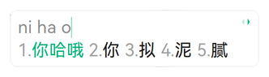

# 仿微信的 fcitx4 输入法皮肤 / WeChat Light for fcitx4

把 [**fcitx5-theme-wechat**](https://github.com/witt-bit/fcitx5-theme-wechat) 的浅色主题移植到 **fcitx4** 的经典界面（`fcitx-classic-ui`），适用于 UOS 20、Deepin 及仍在使用 fcitx4 的发行版。

提供 **两个缩放版本**，按你系统的缩放比例二选一：

| 版本 | 目录 | 适用场景 | `Xft.dpi` |
|---|---|---|---|
| **200%**（HiDPI） | `wechat-2x/` | 4K 屏 + 系统缩放 200% | 192 |
| **100%**（标准） | `wechat-1x/` | 1080p / 无缩放 | 96 |

> **为什么必须二选一**：fcitx4 的候选窗背景图是 **1:1 像素**贴上去的，不随 DPI 放大；而字号会随 DPI 缩放。所以素材必须和缩放比例匹配，否则会出现"字大框小"或"框大字小"。

200% 版效果（实机截图）：


100% 版为同一设计的等比缩小（示意图，非实机截图）：



## 原主题

| | |
|---|---|
| 项目 | **fcitx5-theme-wechat** |
| 仓库 | https://github.com/witt-bit/fcitx5-theme-wechat |
| 作者 | witt |
| 许可 | Apache-2.0 |

原主题面向 **fcitx5**，格式是 `theme.conf` + SVG（9-slice），而 fcitx4 只认 `fcitx_skin.conf` + 九宫格 PNG，**两者不兼容，无法直接安装**。本仓库按原主题的配色、圆角与排版规格，重新绘制了 fcitx4 所需的位图素材，做成语义上尽量接近的移植版。

## 效果与规格对应

| 原主题（fcitx5） | 本移植（fcitx4） |
|---|---|
| 底色 `#ffffff`、描边 `#f0f0f0`、圆角 10 | 白底卡片，`#ECECEC` 描边，圆角 8（1x）/ 16（2x） |
| 高亮 `#02b176` + 白字 | fcitx4 没有「候选项高亮药丸」，改用**首选词绿色**近似 |
| 正文 `#000000` | 候选 `#1A1A1A` |
| 拼音 `#000000` | 拼音/编码 `#8C8C8C` 灰 |

其他细节：光标与翻页箭头同为微信绿 `#02B176`；圆角处透出壁纸（依赖桌面合成器，KWin 下正常）。

## 安装

```sh
git clone https://github.com/TomoeMami/fcitx4-theme-wechat.git
cd fcitx4-theme-wechat

./install.sh        # 会检测 Xft.dpi 并给出建议，直接回车即可
# 或明确指定
./install.sh 2x     # 200% 缩放
./install.sh 1x     # 100% 缩放
```

脚本会做两件事：把对应目录复制到 `~/.config/fcitx/skin/`，并把 `SkinType` 写进 `fcitx-classic-ui.config`。

手动安装也简单：

```sh
cp -r wechat-2x ~/.config/fcitx/skin/     # 或 wechat-1x
```

然后编辑 `~/.config/fcitx/conf/fcitx-classic-ui.config`：

```ini
[ClassicUI]
FontSize=16
SkinType=wechat-2x
```

最后重启 fcitx —— **皮肤只在进程启动时读取**，热重载不生效：

```sh
fcitx-remote -e    # 退出
sleep 2
fcitx -d           # 重新启动
```

### 两个坑

1. **目录必须是 `~/.config/fcitx/skin/`**，不是 `~/.local/share/fcitx/skin/`。
   后者能被扫描到并出现在皮肤列表里，但真正加载时会失败并静默回退到默认皮肤（日志 `skin.c:130 无法加载皮肤`），这是 fcitx4 的路径查找限制。
2. **`SkinType` 写的是目录名**（`wechat-2x` / `wechat-1x`），不是 `fcitx_skin.conf` 里的 `Name=`。

## 关于 DPI 与候选窗变小

fcitx4 的 `classicui.c` 只在**进程启动时**调用一次 `FcitxX11GetDPI()` 读 `Xft.dpi`。如果 fcitx 比桌面环境更早启动（写 `Xft.dpi` 的是 DDE/GNOME 会话管理），它会按 96 DPI 缓存整个会话，候选窗就只有一半大小。

判断方法：

```sh
xrdb -query | grep Xft.dpi      # 当前应为 192（200% 缩放）
```

若 dpi 正常但候选窗偏小，重启一次 fcitx 即可：

```sh
fcitx-remote -e; sleep 2; fcitx -d
```

## 卸载

```sh
rm -rf ~/.config/fcitx/skin/wechat-2x ~/.config/fcitx/skin/wechat-1x
```

再删掉 `fcitx-classic-ui.config` 里的 `SkinType` 行即可回到默认皮肤。

## 自定义

想微调，改对应目录下的 `fcitx_skin.conf`：

| 想要的效果 | 改哪里 |
|---|---|
| 字更大/更小 | `[SkinFont] FontSize`（注意 `classic-ui.config` 里的值优先级更高） |
| 卡片留白更多 | `[SkinInputBar] Margin*` |
| 首选词换色 | `FirstCandColor` / `UserPhraseColor` |
| 候选文字颜色 | `OtherColor` |
| 圆角、描边 | 换 `input.png`（9 宫格，注意保持四角尺寸 = `Margin*`） |

## 许可

沿用原主题的 **Apache-2.0**（见 [LICENSE](LICENSE)），原版权归 witt 与 `fcitx5-theme-wechat` 贡献者所有。

本仓库是在原主题视觉设计基础上的**修改版本**（modification）：将 fcitx5 主题格式转换为 fcitx4 皮肤格式，按 100% / 200% 两种缩放比例重新绘制了全部位图素材。
